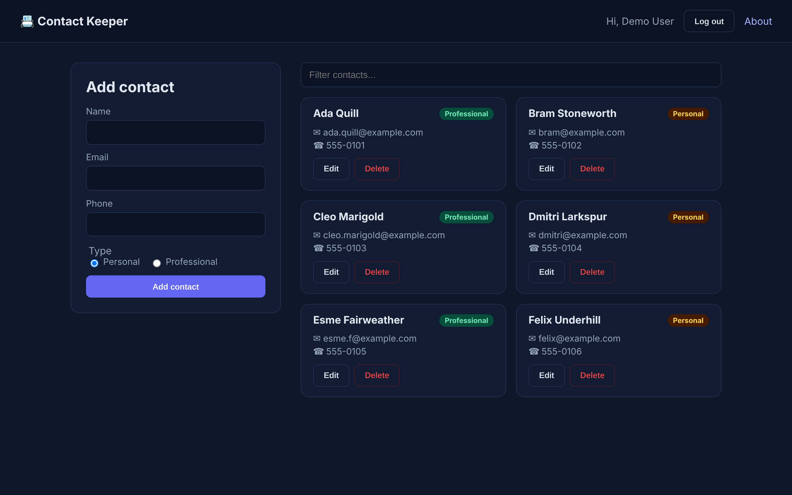

# Contact Keeper

A full stack contact manager: sign up, log in and keep a private list of personal and professional contacts with add, edit, delete and instant filtering.

Originally built in 2019 as a MERN learning project, refreshed in 2026 as a strict TypeScript app with validation, tests and env-only configuration.



## Stack

| Layer | Tech |
| --- | --- |
| Client | React 19, Vite, TypeScript (strict), React Router |
| API | Express 5, TypeScript (strict), zod validation, helmet, CORS |
| Auth | bcrypt password hashing (bcryptjs), JWT bearer tokens |
| Data | MongoDB with Mongoose |
| Tests | Vitest, supertest, mongodb-memory-server, Testing Library |

## Project layout

```
client/   Vite + React app (src/components, src/pages, src/context, src/lib)
server/   Express API (src/routes, src/models, src/middleware, src/scripts)
docs/     Screenshots
```

## Quick start (no database needed)

Requires Node.js 20 or newer.

```bash
npm install
npm run demo
```

This starts an in-memory MongoDB seeded with fictional contacts, the API on port 5000 and the client on http://localhost:5173. Log in with `demo@example.com` / `demo-password-123`. Data is discarded when you stop it.

## Setup with a real database

1. Copy the example env file and fill it in:
   ```bash
   cp .env.example .env
   ```
   - `MONGODB_URI`: a local MongoDB or a MongoDB Atlas connection string
   - `JWT_SECRET`: at least 32 random characters (`openssl rand -base64 48`)
2. Optionally load fictional demo data: `npm run seed`
3. Start API and client together: `npm run dev`

All configuration is read from environment variables. Nothing secret lives in the repo.

## Scripts

| Command | What it does |
| --- | --- |
| `npm run dev` | API (watch mode) and client dev server |
| `npm run demo` | Same, but with an in-memory seeded database |
| `npm run seed` | Reset the demo user and its fictional contacts in `MONGODB_URI` |
| `npm test` | Run server and client test suites |
| `npm run typecheck` | Strict type check of both packages |
| `npm run build` | Compile the API to `server/dist` and the client to `client/dist` |

## API

All contact routes need an `Authorization: Bearer <token>` header and only ever touch the caller's own contacts.

| Method | Path | Body |
| --- | --- | --- |
| POST | `/api/auth/register` | `{ name, email, password }` |
| POST | `/api/auth/login` | `{ email, password }` |
| GET | `/api/auth/me` | |
| GET | `/api/contacts` | |
| POST | `/api/contacts` | `{ name, email?, phone?, type? }` |
| PUT | `/api/contacts/:id` | any contact fields |
| DELETE | `/api/contacts/:id` | |

Invalid input returns `400` with `{ errors: [{ field, msg }] }`.

## Testing

```bash
npm test
```

API tests run against a throwaway in-memory MongoDB, so no setup is required.

## Deploying to Vercel

The repo is ready for a single Vercel project (no separate API host):

- `vercel.json` builds the client (`client/dist`) as static output and rewrites `/api/*` to one Vercel Function.
- `api/index.ts` re-exports `server/src/serverless.ts`, which validates env, connects to MongoDB once per cold start and reuses the connection while the instance is warm.
- All other paths fall back to `index.html` for client side routing.

Set these environment variables in the Vercel project:

| Variable | Required | Notes |
| --- | --- | --- |
| `MONGODB_URI` | yes | e.g. a MongoDB Atlas free cluster connection string |
| `JWT_SECRET` | yes | 32+ random characters |
| `JWT_EXPIRES_IN` | no | defaults to `7d` |
| `CLIENT_ORIGIN` | no | only needed if the client is served from a different origin |

You can check the build locally with `npx vercel build` (no deploy).

## Built with AI-assisted development

The 2026 refresh (TypeScript port, validation, tests and docs) was built with AI-assisted development and reviewed by me.

## License

ISC
